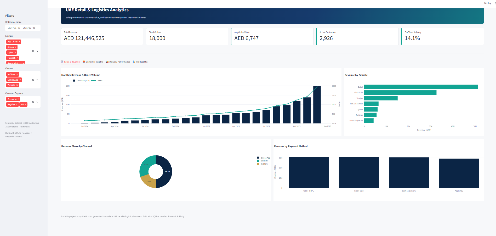

# UAE Retail & Logistics Analytics Dashboard

An end-to-end Data Analytics project using Python, SQL, SQLite, Pandas, and Streamlit to analyze retail sales, customer behavior, product performance, and last-mile delivery across the seven Emirates of the UAE.

## 1. Project Overview

Retail businesses generate large amounts of data through customer orders, product sales, payment transactions, warehouses, and delivery operations.

This project analyzes retail and logistics data to identify business trends, understand customer purchasing behavior, evaluate product performance, and monitor delivery efficiency.

The project covers data generation, ETL pipeline development, database management, Exploratory Data Analysis (EDA), SQL analysis, and interactive dashboard development.

## 2. Project Objectives

- Analyze monthly sales and revenue trends.
- Identify high-revenue Emirates and product categories.
- Understand customer purchasing behavior using RFM analysis.
- Evaluate courier and delivery performance.
- Identify top-performing products.
- Build an interactive dashboard for business insights.

## 3. Dataset Description

The project uses synthetic retail and logistics datasets.

| Dataset | Records |
|---|---:|
| Customers | 3,000 |
| Suppliers | 25 |
| Products | 400 |
| Warehouses | 7 |
| Orders | 18,000 |
| Order Items | 53,871 |
| Deliveries | 14,442 |

### Geographical Coverage

The seven Emirates of the UAE:

- Abu Dhabi
- Dubai
- Sharjah
- Ajman
- Ras Al Khaimah
- Fujairah
- Umm Al Quwain

## 4. Technologies & Tools

| Technology | Purpose |
|---|---|
| Python | Data processing and ETL |
| SQL | Business analysis |
| SQLite | Database management |
| Pandas | Data manipulation |
| NumPy | Numerical operations |
| Matplotlib | Data visualization |
| Jupyter Notebook | Exploratory Data Analysis |
| Plotly | Interactive charts |
| Streamlit | Dashboard development |
| VS Code | Development environment |

## 5. Project Workflow

```text
Synthetic Data Generation
          |
          v
     CSV Datasets
          |
          v
    Python ETL Pipeline
          |
          v
    SQLite Database
          |
          v
     SQL Analysis
          |
          v
 Exploratory Data Analysis
          |
          v
 Streamlit Dashboard
          |
          v
   Business Insights
```

## 6. ETL Pipeline

Developed a Python-based ETL workflow to integrate seven CSV datasets into a SQLite relational database.

### Extract
- Read seven CSV datasets using Pandas.

### Transform
- Prepared relational database schemas.
- Defined primary and foreign keys.
- Organized datasets for analysis.

### Load
- Loaded CSV data into SQLite tables using Pandas and Python's SQLite connector.

### Validation
- Verified table record counts.
- Checked foreign-key relationships.
- Validated data consistency.

## 7. Business Analysis

### Sales & Revenue Analysis
- Monthly revenue and order trends.
- Revenue comparison across Emirates.
- Sales channel performance.
- Payment method analysis.
- Average Order Value (AOV).

### Customer Insights
- RFM customer segmentation.
- Champions/VIP, Loyal, At-Risk, and Churned customers.
- Customer revenue comparison.
- Cohort retention analysis.

### Delivery Performance
- On-time delivery by Emirate.
- Courier performance comparison.
- Delivery outcome analysis.
- Delivery time distribution.

### Product Mix
- Revenue by product category.
- Top 10 products by revenue.
- Product performance comparison.

## 8. Dashboard Features

The interactive Streamlit dashboard contains four major sections.

### Sales & Revenue
- Monthly revenue trends.
- Revenue by Emirate.
- Revenue by sales channel.
- Payment method analysis.

### Customer Insights
- RFM segmentation.
- Customer segment distribution.
- Lifetime revenue by segment.
- Cohort retention.

### Delivery Performance
- On-time delivery by Emirate.
- On-time delivery by courier.
- Delivery outcome breakdown.
- Delivery time distribution.

### Product Mix
- Revenue by category.
- Top 10 products by revenue.

### Interactive Filters
- Order date range.
- Emirate.
- Sales channel.
- Customer segment.

## 9. Key Business Insights

Analysis of the generated dataset revealed:

- **Revenue:** Electronics generated the highest category revenue.
- **Geographical Performance:** Dubai and Abu Dhabi contributed approximately 69.16% of total revenue.
- **Customer Value:** VIP customers had the highest average revenue per customer.
- **Sales Channel:** Online App generated the highest order volume.
- **Courier Performance:** Aramex recorded the highest observed on-time delivery rate.
- **Delivery Time:** Median delivery time was 2 days in the dashboard analysis.

## 10. Project Folder Structure

```text
uae-retail-logistics-analytics/
│
├── Dashboard/
│   └── app.py
│
├── DashboardImages/
│   ├── Sales&Revenue.png
│   ├── CustomerInsights.png
│   ├── DeliveryPerformance.png
│   └── ProductMix.png
│
├── Data/
│   ├── customers.csv
│   ├── suppliers.csv
│   ├── products.csv
│   ├── warehouses.csv
│   ├── orders.csv
│   ├── order_items.csv
│   └── deliveries.csv
│
├── Notebooks/
│   └── 01_eda.ipynb
│
├── Python/
│   ├── generate_data.py
│   ├── etl.py
│   ├── verify_db.py
│   └── run_query.py
│
├── Sql/
│   ├── 01_schema.sql
│   └── 02_business_queries.sql
│
├── .gitignore
├── requirements.txt
└── README.md
```

## 11. Installation & Setup

### Step 1: Clone the repository

```bash
git clone YOUR_GITHUB_REPOSITORY_URL
```

### Step 2: Navigate to the project folder

```bash
cd uae-retail-logistics-analytics
```

### Step 3: Create a virtual environment

```bash
python -m venv .venv
```

### Step 4: Activate the environment

Windows PowerShell:

```powershell
.venv\Scripts\Activate
```

### Step 5: Install dependencies

```bash
pip install -r requirements.txt
```

## 12. Run the Project

### Generate datasets

```bash
python Python/generate_data.py
```

### Execute ETL pipeline

```bash
python Python/etl.py
```

### Verify database

```bash
python Python/verify_db.py
```

### Run Streamlit dashboard

```bash
python -m streamlit run Dashboard/app.py
```

Open the local URL displayed in your terminal.

## 13. Dashboard Screenshots

### Sales & Revenue



### Customer Insights


### Delivery Performance


### Product Mix


## 14. Key Learnings

- Relational database design and SQL querying.
- Python-based ETL pipeline development.
- Data validation and Exploratory Data Analysis.
- RFM customer segmentation.
- Business KPI calculations.
- Interactive dashboard development.
- Translating data into business insights.

## 15. Project Disclaimer

This project uses synthetic data generated for educational and portfolio purposes. The findings represent patterns in the generated dataset and do not represent actual UAE retail market statistics.

---

**Developed as a Data Analytics Portfolio Project**

**Technologies:** Python | SQL | SQLite | Pandas | Plotly | Streamlit
